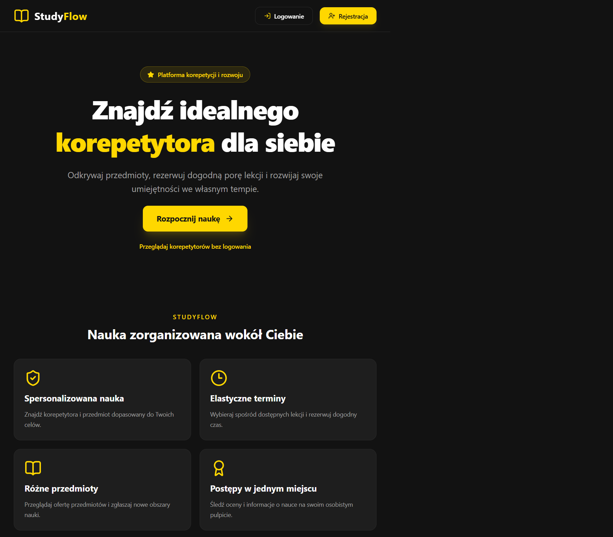
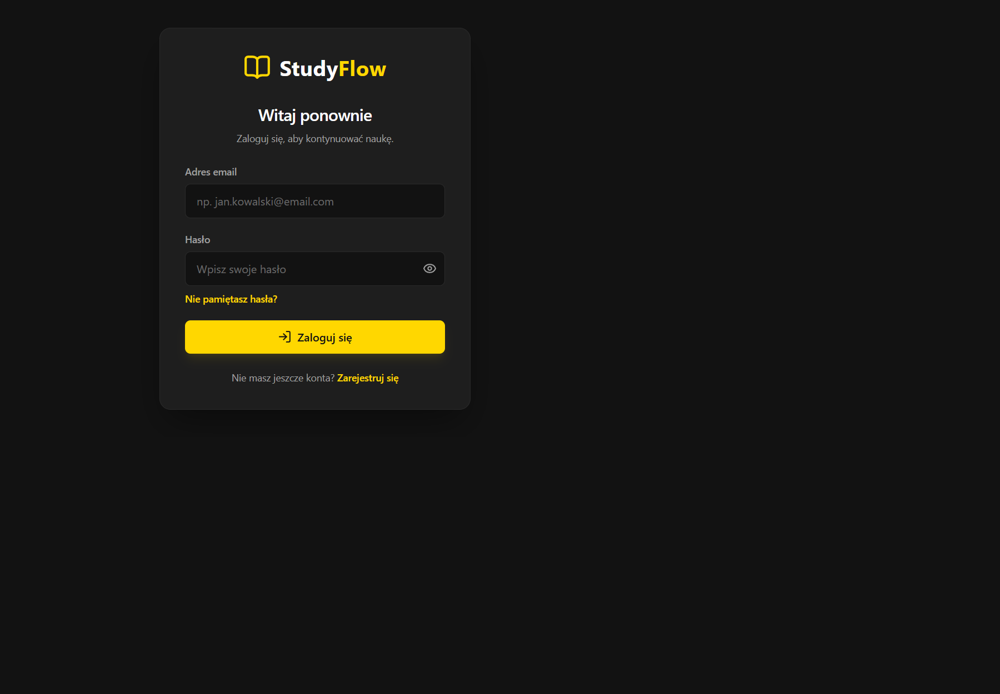

# StudyFlow — System Zarządzania Szkołą Online z Korepetytorami

**StudyFlow** to aplikacja internetowa do organizacji korepetycji i zarządzania szkołą online. Łączy uczniów, korepetytorów i administratorów, umożliwiając rezerwowanie lekcji, śledzenie postępów, ocenianie zajęć oraz generowanie raportów finansowych.

## Zrzuty ekranu

Zrzuty pokazują lokalną wersję interfejsu; logowanie wymaga uruchomionego API.





## 🛠️ Stos technologiczny

- **Backend:** NestJS, TypeScript, Prisma ORM, SQLite, JWT, Bcrypt
- **Frontend:** React, TypeScript, Vite, Tailwind CSS, Lucide Icons, Axios

## 📋 Wymagania wstępne

- **Node.js** w wersji `v24.15` lub nowszej oraz **npm**
- **Git**

Projekt używa SQLite, czyli bazy przechowywanej w lokalnym pliku. Nie musisz instalować ani uruchamiać PostgreSQL, Dockera ani osobnego serwera bazy danych.

> Baza SQLite zaczyna jako nowa baza. Istniejące dane z PostgreSQL nie są przenoszone automatycznie.

## 🚀 Uruchomienie projektu

### 1. Sklonuj repozytorium

W terminalu wykonaj:

```powershell
git clone https://github.com/marta522/StudyFlow.git
cd StudyFlow
```

### 2. Skonfiguruj i uruchom backend

#### Przygotuj backend

W pierwszym oknie terminala przejdź do katalogu backendu i zainstaluj zależności:

```powershell
cd studyflow-backend
npm install
```

Skopiuj `studyflow-backend/.env.example` do pliku `.env` w katalogu backendu.
W PowerShellu użyj:

```powershell
Copy-Item .env.example .env
```

W macOS/Linux użyj:

```bash
cp .env.example .env
```

Ustaw w `.env` unikalny `JWT_SECRET` (co najmniej 32 znaki) oraz `CORS_ORIGINS`
na dokładne adresy frontendu, oddzielone przecinkami. Plik bazy danych zostanie
utworzony w `studyflow-backend/prisma/dev.db`.
Sekret można wygenerować poleceniem `node -e "console.log(require('crypto').randomBytes(48).toString('hex'))"`.

Opcjonalnie: `APP_TIMEZONE` (domyślnie `Europe/Warsaw`) określa strefę czasową
szkoły, w której sprawdzane jest, czy lekcja już się rozpoczęła lub zakończyła.
Za serwerem proxy (np. nginx) ustaw `TRUST_PROXY` na liczbę serwerów pośrednich
(np. `1`; domyślnie `loopback`), aby limity prób logowania były liczone dla
każdego użytkownika osobno.

#### Utwórz bazę i opcjonalnie dodaj konta testowe

Zastosuj migrację tworzącą tabele:

```powershell
npx prisma migrate deploy
```

Jeśli chcesz zalogować się na konta testowe, opcjonalnie uruchom seed:

```powershell
$env:SEED_DEMO_RESET = "true"
npx prisma db seed
Remove-Item Env:SEED_DEMO_RESET
```

W Git Bash lub macOS/Linux, z katalogu `studyflow-backend`, uruchom:

```bash
SEED_DEMO_RESET=true npx prisma db seed
```

> Seed usuwa dane z lokalnej bazy przed dodaniem danych demonstracyjnych. Uruchamiaj go tylko przy pierwszej konfiguracji albo wtedy, gdy chcesz zresetować bazę.

#### Uruchom backend

W tym samym terminalu uruchom serwer:

```powershell
npm run start:dev
```

API będzie dostępne pod adresem `http://localhost:3000/api`. Pozostaw ten terminal otwarty.

### 3. Zainstaluj i uruchom frontend

Otwórz **drugie okno terminala**. Z katalogu głównego projektu wykonaj:

```powershell
cd studyflow-frontend
npm install
npm run dev
```

Frontend będzie dostępny pod adresem `http://localhost:5173`. Otwórz ten adres w przeglądarce. Pozostaw również drugi terminal otwarty.

Jeśli frontend wymaga wskazania adresu API, utwórz plik `.env` w katalogu `studyflow-frontend`:

```env
VITE_API_BASE_URL=http://localhost:3000/api
```

Po zmianie `.env` uruchom ponownie serwer Vite.

## 🔐 Konta testowe

Konta są dostępne po uruchomieniu opcjonalnego seeda demonstracyjnego:

| Rola | Email | Hasło |
|---|---|---|
| 👑 Administrator | `admin@studyflow.pl` | `Haslo123` |
| 🎓 Korepetytor | `tutor@studyflow.pl` | `Haslo123` |
| 📚 Uczeń | `student@studyflow.pl` | `Haslo123` |

Te konta i hasła są wyłącznie do lokalnych testów — nie używaj ich w produkcji.

## 🌿 Wprowadzanie zmian

Przed wprowadzaniem zmian utwórz osobny branch zamiast pracować bezpośrednio na głównej gałęzi:

```powershell
git switch -c nazwa-twojego-brancha
```

## Bezpieczeństwo wdrożenia

Sesja używa cookie `httpOnly`, `SameSite=Lax` i `Secure` w produkcji; żądania
zmieniające dane wymagają ochrony CSRF. Używaj HTTPS, ogranicz `CORS_ORIGINS`
do zaufanych adresów frontendu i ustaw `TRUST_PROXY` zgodnie z liczbą/adresami
proxy w środowisku wdrożeniowym (lokalnie pozostaw `loopback`). Dokumentacja
Swagger jest domyślnie dostępna pod `/api/docs` poza środowiskiem produkcyjnym;
w produkcji można ją włączyć wyłącznie przez `ENABLE_SWAGGER=true`.
Udział wynagrodzenia korepetytora w koszcie lekcji konfiguruje
`TUTOR_SALARY_PERCENT` (domyślnie `80`, zakres `0`–`100`).
Migracja katalogu usuwa zduplikowane nazwy przedmiotów i oferty korepetytorów,
zachowując rekordy z najniższym ID; przed wdrożeniem migracji wykonaj kopię
zapasową bazy danych.

Jeśli `.env` był częścią udostępnionego ZIP-a, wygeneruj nowy `JWT_SECRET`
poleceniem
`node -e "console.log(require('crypto').randomBytes(48).toString('hex'))"`,
ustaw go we wszystkich instancjach backendu i zrestartuj je. Stare sesje
staną się nieważne. Przed archiwizacją wyklucz `.env`, `dist/`, `.git/` i
`prisma/*.db`; root `.gitignore` zawiera odpowiednie reguły.
